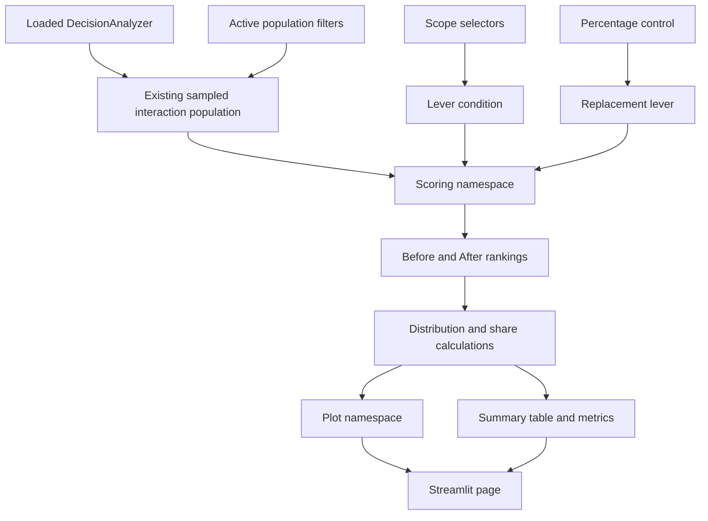
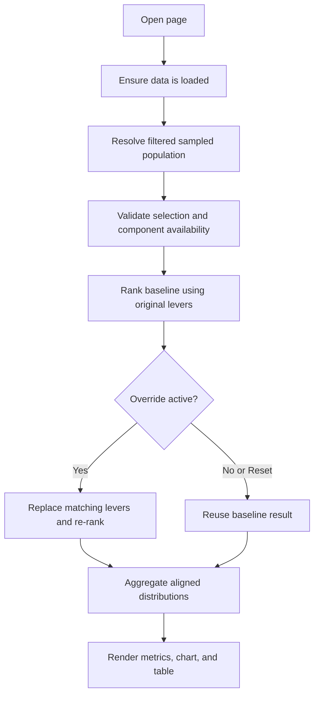

# What-if Business Levers - Design

**Status:** Implemented prototype
**Application:** Decision Analysis Tool

## Executive Summary

Add a **What-if: Business Levers** page that illustrates how replacing lever
values changes the winning-offer distribution. Users select an Issue, Group, or
individual Action, set a percentage relative to the neutral lever, and compare
Before and After results.

The percentage specifies an absolute replacement, not a multiplication of
existing levers:

| UI adjustment | Replacement lever |
|---|---:|
| -10% | 0.90 |
| 0% | 1.00 |
| +10% | 1.10 |

Support one adjustment at a time. Do not update product configuration or predict
customer responses. The page is registered as What-if: Business Levers alongside Arbitration
Distribution and uses the existing scoring and treemap infrastructure.

## Key Concepts & Principles

### Lever replacement

For matching candidates:

```text
Scenario lever = 1 + adjustment_percent / 100
Scenario priority = Propensity * Value * Context Weight * Scenario lever
```

All other candidates retain their existing levers.

### Baseline and Reset

Both scenarios use the same priority calculation and ranking engine:

- **Before:** original component values, including original levers.
- **After:** selected candidates receive the replacement lever.
- **Reset:** removes the override completely.

**0% is not Reset.** Replacing an existing lever of 2.0 with 1.0 changes the
scenario. Initially, no override is active and both distributions are identical.

The baseline is a reconstructed arbitration result, not necessarily the recorded
output: exported priorities can differ from the available component product. The
page must explain this distinction. Using the same reconstruction for both
scenarios isolates the effect of replacing levers.

### Competition remains intact

Scope selectors define which candidates change, not which candidates participate.
All competitors in the active analysis population remain present.

Action identity uses Issue + Group + Action. Group identity uses Issue + Group.
This prevents collisions between identically named branches.

Population filters are independent of the adjustment scope. They apply equally
to both scenarios and define the population being analyzed. The target selectors
must not add population filters that remove competing offers.

### Limited simulation scope

- Rank-1 winning offers only.
- Arbitration-eligible candidates only.
- Existing mandatory-action precedence and deterministic tie-breaking remain
  unchanged.
- Existing interaction-level sampling is retained.
- No rerun of eligibility, contact policies, or downstream delivery.
- No multiple overrides, saved scenarios, target-share search, or generic
  simulation framework.

## User Experience

### Controls

1. **Adjust at:** Issue / Group / Action.
2. Cascading selectors for the required hierarchy.
3. **Lever adjustment relative to neutral (1.0):** percentage slider from -50%
   to +50%, in 1-percentage-point steps.
4. **Reset:** a separate control that removes the override completely.
5. Explicit replacement preview, for example:

   > Set the lever to **1.10** for all actions in **Sales / Cards**.
   > Existing lever values are replaced.

For the prototype, use a bounded range of -50% to +50%, corresponding to
levers of 0.50 to 1.50. This is a demonstration limit, not a claimed product
constraint.

### Results

- Selected scope's offer share before, after, and percentage-point change.
- Side-by-side Before / After treemaps, reusing the existing **Offer Mix by
  Volume** visualization from the Action Distribution page.
- A table containing offer identity, before/after counts, shares, and change.
- Both treemaps retain the same Issue / Group / Action hierarchy, regardless of
  the adjustment level, and use the existing Issue color mappings and Pega
  template. Users can explore the hierarchy as they do on Action Distribution.
- Full hierarchy appears in labels or hover text.
- Tile area represents rank-1 winning-offer counts, not all candidate appearances
  at a pipeline stage. Titles and captions make this distinction explicit.
- Zero-win offers need not occupy tiles, but the table retains the complete
  before/after distribution, including offers that gain or lose all wins.
- One summary line beneath the table reports the number of re-evaluated
  arbitration decisions and the measured simulation time in seconds.

Reuse `distribution_as_treemap()` twice rather than introducing a new chart type
or paired-chart framework. Prepare each scenario's input in the library with
Issue, Group, Action, and a `Decisions` column containing that scenario's win
count, then pass it to the existing plotting method as a LazyFrame. Use
Before and After labels rather than implying these are recorded pipeline stages.
Include **No winning offer** consistently in both inputs when its count is
nonzero. The summary and table expose population-based shares explicitly; do not
mistake a treemap's parent-relative percentages for those shares.

Show the sampled interaction count and label results as an illustrative
simulation. Explain that mandatory precedence can prevent a lever adjustment
from changing a winner.

## Architecture Overview



All calculations, aggregations, and plot construction live in the library.
Streamlit composes controls, translates widget state into library arguments,
and renders results.

## Data Model & Schemas

### Input

| Column | Purpose |
|---|---|
| Interaction ID | Ranking boundary |
| Issue, Group, Action | Hierarchical identity |
| Propensity, Value, Context Weight, Levers | Priority components |
| Priority | Existing ranking eligibility |
| Stage metadata | Arbitration eligibility |
| is_mandatory | Existing ranking precedence |

Use existing normalization and component-default conventions. Missing or null
components treated as neutral must be disclosed rather than silently presented
as complete data.

### Output

`Scoring.lever_simulation()` returns two DataFrames: an action-level distribution
and a one-row selected-scope summary. The distribution contains:

| Field | Meaning |
|---|---|
| Issue, Group, Action | Full identity |
| Selected | Whether the replacement applies |
| Before | Baseline rank-1 wins |
| After | Scenario rank-1 wins |
| Before share (%), After share (%) | Population-based winning-offer shares |
| Change (pp) | After share minus Before share |

The summary contains Interactions, Re-evaluated decisions, Elapsed (s), and the
selected scope's Before, After, Before share (%), After share (%), and Change
(pp). Re-evaluated decisions counts distinct interactions with rankable
arbitration candidates in the sampled, filtered population, not all loaded
interactions. Elapsed (s) measures scoring and aggregation with a monotonic clock;
it excludes plot construction and rendering. The legacy
`get_win_distribution_data()` API remains unchanged.

The denominator is the same filtered sampled interaction population for both
scenarios, measured before restricting candidates to arbitration. Interactions
without an eligible winner appear as **No winning offer**, consistently counted
before and after. Lever replacement cannot create an eligible candidate where
none existed.

```text
Offer share (%) = 100 * offer win count / analyzed interaction count
Change (percentage points) = after share - before share
```

Use the actual sampled population count, not a full-data count combined with
sampled winners.

## Class Hierarchy & Key Components

Reuse existing components; introduce no new analyzer hierarchy.

- **Scoring:** extend existing lever distribution logic to support consistent
  baseline/scenario ranking and active population filters.
- **Scope utilities:** reuse hierarchy selection patterns, ensuring action
  matching includes Issue and Group.
- **Plots:** reuse the existing distribution treemap method for both scenarios,
  preserving the app's established hierarchy, colors, and visual style.
- **Streamlit page:** manage selection and replacement state using existing
  shared page utilities.
- **Navigation:** register the page only when decision data is loaded.

The existing `get_win_distribution_data()` helper continues to count baseline
winners using recorded Rank. The new `lever_simulation()` method intentionally
compares reconstructed rankings without changing that legacy behavior.

## Process Diagrams



Changing an Issue clears incompatible Group and Action selections. Changing a
Group clears an incompatible Action selection. A data or population change
invalidates incompatible selections and previously computed results.

## APIs and Extension Points

Extend existing scoring entry points and reuse the distribution treemap plotting
entry point rather than adding a generic scenario framework.

Required library capabilities:

- Apply a lever condition with an absolute replacement value.
- Accept population filters independently of the lever condition.
- Produce baseline and scenario counts from one consistent candidate population.
- Aggregate by Issue, Group, or Action using complete hierarchy keys.
- Provide the existing treemap input shape for each scenario. No new plot API is
  needed; any necessary extension must preserve existing callers.

The focused API preserves the legacy helper's recorded-baseline semantics:

```python
distribution, summary = da.scoring.lever_simulation(
    (pl.col("Issue") == "Sales") & (pl.col("Group") == "Cards"),
    lever_value=1.10,
    additional_filters=pl.col("Channel") == "Web",
)
```

Pass `lever_value=None` to remove the override. Values outside 0.50 to 1.50 or
non-finite values raise ValueError. Empty populations or targets without eligible
candidates also raise actionable ValueErrors.

Do not change the shared sensitivity-ranking engine's default behavior merely
to serve this page. Plot methods return figures and do not display them.

## Configuration Settings

| Setting | Proposed behavior |
|---|---|
| Percentage slider | -50% to +50%, step 1 percentage point |
| Initial state | No override |
| Winning rank | 1, fixed |
| Sampling | Existing analyzer configuration |
| State keys | Page-specific persisted-widget pattern |

Do not mutate the shared analyzer or source data. Recompute when data,
population filters, selection, or override changes. Begin without an additional
cache layer; introduce caching only if measured performance warrants it, using
the existing data fingerprint and Polars hashing patterns.

## Observability & Management

Display the effective replacement lever, selected hierarchy, active population
filters, analyzed interaction count, and sampling/reconstruction caveats.
Below the table, show a single summary line such as:

> Re-evaluated **2,345 decisions** at arbitration in **0.125 s**
> (sampled, filtered population; scoring and aggregation only).

Distinguish re-evaluated decisions from the share denominator: interactions
without a rankable arbitration candidate contribute to No winning offer but
are not re-evaluated. Timing is measured for each run, not a fixed demonstration
value.

Use module logging for technical diagnostics. No scenario persistence, audit
database, external telemetry, or product write-back is required.

## Error Handling & Diagnostics

- Missing data: use the existing `ensure_data()` guard.
- Empty population or no arbitration candidates: show a warning, not a
  misleading chart.
- Selection absent after filtering: clear it and require reselection.
- Invalid percentage or non-finite lever: raise an actionable validation error
  at the library boundary.
- Missing components: disclose neutral assumptions; stop if ranking cannot
  be performed.
- Zero denominator: show an explicit empty state rather than fabricated shares.

Do not silently replace failed calculations with empty or zero-valued results.

## Dependencies

Use existing Polars, Plotly, Streamlit, and pytest dependencies. No new packages
or external services are required.

## Acceptance Tests

Focused exact-value tests must demonstrate:

1. **Replacement, not multiplication:** an original lever of 2.0 becomes 1.10
   for +10%. With other components equal to 1.0 and a competitor at 1.5,
   the selected action loses after replacement rather than winning at 2.2.
2. **Winner changes:** a selected priority of 1.0 overtakes a competitor at
   1.05 when its neutral lever becomes 1.10.
3. **Decrease:** -10% produces a lever of 0.90 and the expected ranking.
4. **Hierarchy isolation:** duplicate action/group names outside the selected
   branch remain unchanged.
5. **Competition retained:** unselected offers can win or lose against the
   adjusted scope.
6. **Reset versus 0%:** Reset restores original levers; 0% replaces them with
   1.0.
7. **Consistent totals:** before/after shares use identical denominators,
   including no-winner interactions.
8. **Ranking rules:** mandatory precedence and deterministic ties are preserved.
9. **Reconstructed baseline:** recorded priorities that differ from the
   component product do not introduce spurious baseline/scenario differences
   when the effective lever is unchanged.
10. **Validation:** non-finite/out-of-range replacement values and empty
    populations produce explicit errors or documented empty states.
11. **Slider boundaries:** -50% replaces the lever with 0.50 and +50% replaces
    it with 1.50, producing the expected winners and offer shares.
12. **Count and timing:** verify distinct arbitration interactions separately
    from the share denominator, and test elapsed time with a controlled clock.
    The page displays both values in one line beneath the table.

Streamlit state-transition tests cover cascading selectors, slider changes,
Reset, and changes to the active population. Verify both slider
endpoints, initial no-override state,
and selection invalidation after a data change.

Run the narrow scoring, plotting, and page tests covering these changes.
Visually check treemap label clipping, consistent Issue colors and hierarchy,
and Before / After readability. Verify exact scenario counts in the library
inputs and table rather than using tile presence as a correctness assertion.

## Footnotes & References

- [Decision Analyzer architecture](../../../docs/decision-analyzer-architecture.md)
- [Scoring and lever distribution helpers](_scoring.py)
- [Scope configuration and filtering utilities](utils.py)
- [Existing win/loss distribution plotting](plots/_winloss.py)
- [Reusable distribution treemap](plots/_distribution.py)
- [Action Distribution page](../app/decision_analyzer/pages/3_Action_Distribution.py)
- [App navigation](../app/decision_analyzer/_navigation.py)
- [Business Levers page](../app/decision_analyzer/pages/13_Business_Levers.py)
- [Existing Win/Loss page](../app/decision_analyzer/pages/6_Win_Loss_Analysis.py)
- [Decision Analyzer tests](../../tests/decision_analyzer/test_DecisionAnalyzer.py)
- [Win/loss plot tests](../../tests/decision_analyzer/test_plots_winloss.py)
- [Lever page interaction tests](../../tests/streamlit_apps/decision_analyzer/test_business_levers.py)

## Delivery Scope

The prototype includes library simulation, the page and navigation, directly
related documentation, and focused tests. It does not implement saved scenarios,
product write-back, or any unrelated backlog items.
