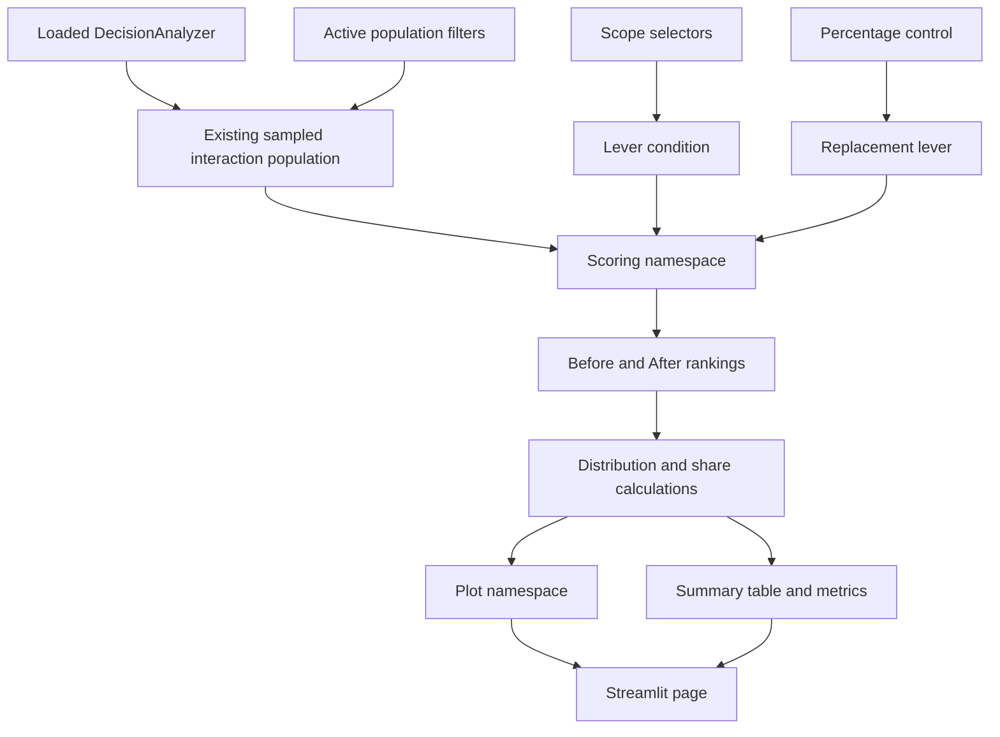
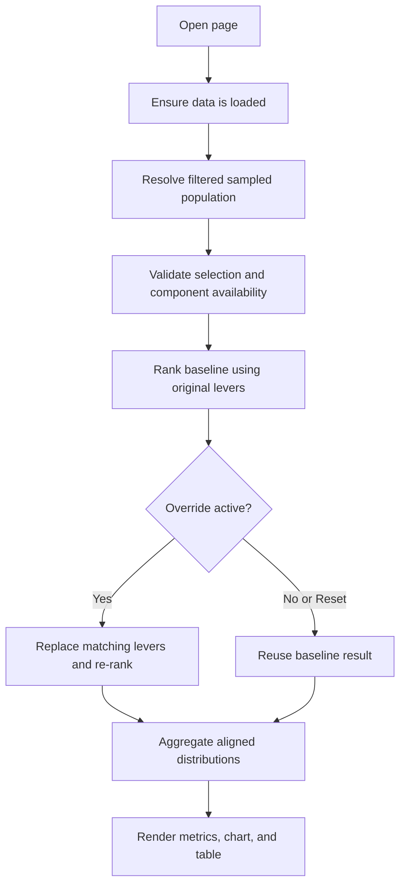

# What-if Business Levers - Design

**Status:** Proposed prototype
**Application:** Decision Analysis Tool

## Executive Summary

Add a **What-if: Business Levers** page that illustrates how replacing lever
values changes the winning-offer distribution. Users select an Issue, Group, or
individual Action, set a percentage relative to the neutral lever, and compare
Before and After results.

The percentage specifies an absolute replacement, not a multiplication of
existing levers:

| UI adjustment | Replacement lever |
|---|---:|
| -10% | 0.90 |
| 0% | 1.00 |
| +10% | 1.10 |

Support one adjustment at a time. Do not update product configuration or predict
customer responses. The existing scoring and plotting helpers provide a starting
point, but no what-if page is currently registered in the app navigation.

## Key Concepts & Principles

### Lever replacement

For matching candidates:

```text
Scenario lever = 1 + adjustment_percent / 100
Scenario priority = Propensity * Value * Context Weight * Scenario lever
```

All other candidates retain their existing levers.

### Baseline and Reset

Both scenarios use the same priority calculation and ranking engine:

- **Before:** original component values, including original levers.
- **After:** selected candidates receive the replacement lever.
- **Reset:** removes the override completely.

**0% is not Reset.** Replacing an existing lever of 2.0 with 1.0 changes the
scenario. Initially, no override is active and both distributions are identical.

The baseline is a reconstructed arbitration result, not necessarily the recorded
output: exported priorities can differ from the available component product. The
page must explain this distinction. Using the same reconstruction for both
scenarios isolates the effect of replacing levers.

### Competition remains intact

Scope selectors define which candidates change, not which candidates participate.
All competitors in the active analysis population remain present.

Action identity uses Issue + Group + Action. Group identity uses Issue + Group.
This prevents collisions between identically named branches.

Population filters are independent of the adjustment scope. They apply equally
to both scenarios and define the population being analyzed. The target selectors
must not add population filters that remove competing offers.

### Limited simulation scope

- Rank-1 winning offers only.
- Arbitration-eligible candidates only.
- Existing mandatory-action precedence and deterministic tie-breaking remain
  unchanged.
- Existing interaction-level sampling is retained.
- No rerun of eligibility, contact policies, or downstream delivery.
- No multiple overrides, saved scenarios, target-share search, or generic
  simulation framework.

## User Experience

### Controls

1. **Adjust at:** Issue / Group / Action.
2. Cascading selectors for the required hierarchy.
3. **Lever adjustment relative to neutral (1.0):** percentage slider from -50%
   to +50%, in 1-percentage-point steps.
4. **Reset:** a separate control that removes the override completely.
5. Explicit replacement preview, for example:

   > Set the lever to **1.10** for all actions in **Sales / Cards**.
   > Existing lever values are replaced.

For the prototype, use a bounded range of -50% to +50%, corresponding to
levers of 0.50 to 1.50. This is a demonstration limit, not a claimed product
constraint.

### Results

- Selected scope's offer share before, after, and percentage-point change.
- Horizontal grouped bars showing Before / After offer share.
- A table containing offer identity, before/after counts, shares, and change.
- Default display granularity matches the adjustment level.
- Full hierarchy appears in labels or hover text.
- Any display truncation uses the same categories in both scenarios, with
  remaining categories aggregated as **Other**. Keep the selected category
  visible. The table retains the complete distribution.

Show the sampled interaction count and label results as an illustrative
simulation. Explain that mandatory precedence can prevent a lever adjustment
from changing a winner.

## Architecture Overview



All calculations, aggregations, and plot construction live in the library.
Streamlit composes controls, translates widget state into library arguments,
and renders results.

## Data Model & Schemas

### Input

| Column | Purpose |
|---|---|
| Interaction ID | Ranking boundary |
| Issue, Group, Action | Hierarchical identity |
| Propensity, Value, Context Weight, Levers | Priority components |
| Priority | Existing ranking eligibility |
| Stage metadata | Arbitration eligibility |
| is_mandatory | Existing ranking precedence |

Use existing normalization and component-default conventions. Missing or null
components treated as neutral must be disclosed rather than silently presented
as complete data.

### Output

One row per action identity:

| Field | Meaning |
|---|---|
| Issue, Group, Action | Full identity |
| selected_action | Whether the replacement applies |
| original_win_count | Baseline rank-1 wins |
| new_win_count | Scenario rank-1 wins |

Retain existing helper fields where required for compatibility. Library
aggregation derives before/after shares, percentage-point changes, and
selected-scope totals.

The denominator is the same filtered sampled interaction population for both
scenarios, measured before restricting candidates to arbitration. Interactions
without an eligible winner appear as **No winning offer**, consistently counted
before and after. Lever replacement cannot create an eligible candidate where
none existed.

```text
Offer share (%) = 100 * offer win count / analyzed interaction count
Change (percentage points) = after share - before share
```

Use the actual sampled population count, not a full-data count combined with
sampled winners.

## Class Hierarchy & Key Components

Reuse existing components; introduce no new analyzer hierarchy.

- **Scoring:** extend existing lever distribution logic to support consistent
  baseline/scenario ranking and active population filters.
- **Scope utilities:** reuse hierarchy selection patterns, ensuring action
  matching includes Issue and Group.
- **Plots:** add a paired comparison chart in the existing win/loss plotting
  area.
- **Streamlit page:** manage selection and replacement state using existing
  shared page utilities.
- **Navigation:** register the page only when decision data is loaded.

The existing absolute-replacement behavior remains supported. Changes to shared
helper behavior require auditing its tests and callers. In particular, the
current helper counts baseline winners using recorded Rank, whereas this design
compares reconstructed rankings. Treat that difference as an intentional,
documented change, not an incidental refactor.

## Process Diagrams



Changing an Issue clears incompatible Group and Action selections. Changing a
Group clears an incompatible Action selection. A data or population change
invalidates incompatible selections and previously computed results.

## APIs and Extension Points

Extend existing scoring and plotting entry points rather than adding a generic
scenario framework.

Required library capabilities:

- Apply a lever condition with an absolute replacement value.
- Accept population filters independently of the lever condition.
- Produce baseline and scenario counts from one consistent candidate population.
- Aggregate by Issue, Group, or Action using complete hierarchy keys.
- Return chart data through the standard keyword-only `return_df` pattern,
  with typed overloads.

The existing `get_win_distribution_data()` helper already supports absolute
replacement and is the first reuse candidate. Preserve existing call signatures
unless a directly related change is necessary; inspect callers before deciding
whether to extend it or add a focused method to the existing Scoring namespace.

Do not change the shared sensitivity-ranking engine's default behavior merely
to serve this page. Plot methods return figures and do not display them.

## Configuration Settings

| Setting | Proposed behavior |
|---|---|
| Percentage slider | -50% to +50%, step 1 percentage point |
| Initial state | No override |
| Winning rank | 1, fixed |
| Sampling | Existing analyzer configuration |
| State keys | Page-specific persisted-widget pattern |

Do not mutate the shared analyzer or source data. Recompute when data,
population filters, selection, or override changes. Begin without an additional
cache layer; introduce caching only if measured performance warrants it, using
the existing data fingerprint and Polars hashing patterns.

## Observability & Management

Display the effective replacement lever, selected hierarchy, active population
filters, analyzed interaction count, and sampling/reconstruction caveats.

Use module logging for technical diagnostics. No scenario persistence, audit
database, external telemetry, or product write-back is required.

## Error Handling & Diagnostics

- Missing data: use the existing `ensure_data()` guard.
- Empty population or no arbitration candidates: show a warning, not a
  misleading chart.
- Selection absent after filtering: clear it and require reselection.
- Invalid percentage or non-finite lever: raise an actionable validation error
  at the library boundary.
- Missing components: disclose neutral assumptions; stop if ranking cannot
  be performed.
- Zero denominator: show an explicit empty state rather than fabricated shares.

Do not silently replace failed calculations with empty or zero-valued results.

## Dependencies

Use existing Polars, Plotly, Streamlit, and pytest dependencies. No new packages
or external services are required.

## Acceptance Tests

Focused exact-value tests must demonstrate:

1. **Replacement, not multiplication:** an original lever of 2.0 becomes 1.10
   for +10%. With other components equal to 1.0 and a competitor at 1.5,
   the selected action loses after replacement rather than winning at 2.2.
2. **Winner changes:** a selected priority of 1.0 overtakes a competitor at
   1.05 when its neutral lever becomes 1.10.
3. **Decrease:** -10% produces a lever of 0.90 and the expected ranking.
4. **Hierarchy isolation:** duplicate action/group names outside the selected
   branch remain unchanged.
5. **Competition retained:** unselected offers can win or lose against the
   adjusted scope.
6. **Reset versus 0%:** Reset restores original levers; 0% replaces them with
   1.0.
7. **Consistent totals:** before/after shares use identical denominators,
   including no-winner interactions.
8. **Ranking rules:** mandatory precedence and deterministic ties are preserved.
9. **Reconstructed baseline:** recorded priorities that differ from the
   component product do not introduce spurious baseline/scenario differences
   when the effective lever is unchanged.
10. **Validation:** non-finite/out-of-range replacement values and empty
    populations produce explicit errors or documented empty states.
11. **Slider boundaries:** -50% replaces the lever with 0.50 and +50% replaces
    it with 1.50, producing the expected winners and offer shares.

Streamlit state-transition tests cover cascading selectors, slider changes,
Reset, and changes to the active population. Verify both slider
endpoints, initial no-override state,
and selection invalidation after a data change.

Run the narrow scoring, plotting, and page tests covering these changes.
Visually check chart label clipping and Before / After category alignment.

## Footnotes & References

- [Decision Analyzer architecture](../../../docs/decision-analyzer-architecture.md)
- [Scoring and lever distribution helpers](_scoring.py)
- [Scope configuration and filtering utilities](utils.py)
- [Existing win/loss distribution plotting](plots/_winloss.py)
- [App navigation](../app/decision_analyzer/_navigation.py)
- [Existing Win/Loss page](../app/decision_analyzer/pages/6_Win_Loss_Analysis.py)
- [Decision Analyzer tests](../../tests/decision_analyzer/test_DecisionAnalyzer.py)
- [Win/loss plot tests](../../tests/decision_analyzer/test_plots_winloss.py)

## Delivery Scope

This document specifies a proposed implementation; it does not claim the page
or changed simulation behavior already exists. Implement the library behavior,
page, navigation, directly related documentation, and focused tests together in
one change. Leave unrelated backlog items untouched.
